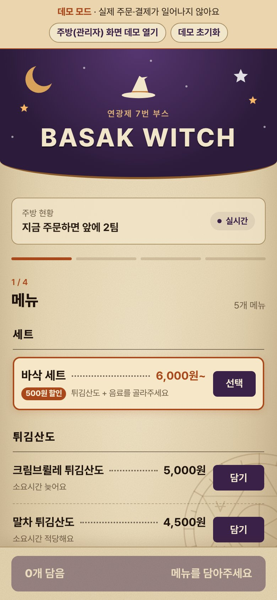
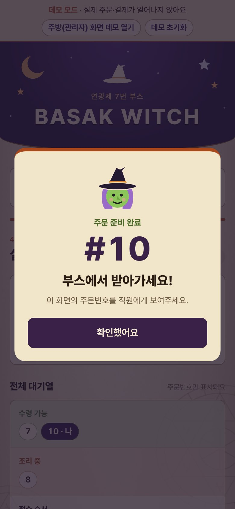
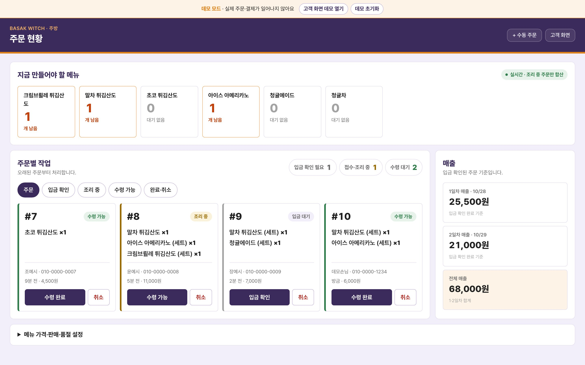

# BASAK WITCH — 연광제 2026 7번 부스 QR 주문 웹앱

| 화면 | 주소 | 비고 |
| --- | --- | --- |
| 고객(일반) | https://jeong93920.github.io/yeongwang2026/ | 실제 운영 DB에 연결됨 |
| 관리자(주방) | https://jeong93920.github.io/yeongwang2026/admin/ | 관리자 로그인 필요 |
| **데모 고객** | https://jeong93920.github.io/yeongwang2026/?demo | 실제 주문·결제 없음 |
| **데모 관리자** | https://jeong93920.github.io/yeongwang2026/admin/?demo | 로그인 없이 주방 화면 |

> 처음 보는 분은 **데모 링크**를 쓰세요. 데모 고객 탭과 데모 관리자 탭을 함께 열어 두고,
> 고객 탭에서 주문 → 관리자 탭에서 `입금 확인` → `수령 가능`을 누르면 고객 탭에 수령 알림이 뜹니다.
> 데모는 브라우저 안(localStorage)에서만 동작하고 실제 DB에는 아무것도 보내지 않습니다. 배너의 `데모 초기화`로 처음 상태로 되돌릴 수 있습니다.

인공지능 수업 중간고사 과제 "본인이 만들고 싶은 앱을 바이브 코딩으로 만들기" 제출물입니다.
9/21에 기존 주문 웹앱을 내 부스용으로 독립 운영하도록 옮기는 것부터 시작해, Claude Code와 대화하며 기능을 요청하고, 폰으로 확인하고, 다시 고쳐 달라고 하는 방식으로 만들었습니다.

---

## 1. 제작한 것 소개

학교 축제 **연광제 2026**(10/28~29)에서 운영한 7번 부스 **BASAK WITCH**(튀김산도·음료)의 주문 웹앱입니다.
손님은 부스 앞 QR 코드를 찍어 폰으로 주문·송금하고, 부스 안에서는 태블릿의 주방 화면으로 주문을 처리합니다.

| 데모 고객 메뉴 | 데모 고객 수령 알림 대기 | 데모 주방 화면 |
| --- | --- | --- |
|  |  |  |

### 고객 화면 (`index.html`)
1. **메뉴** — 바삭 세트(튀김산도 + 음료, 500원 할인), 튀김산도 3종, 음료 2종(청귤에이드는 청귤차로 변경 가능). 품절·남은 수량 표시.
2. **주문 확인** — 수량 조절, 입금자 이름·연락처 입력(공개되지 않음).
3. **송금** — 주문번호와 금액, 토스·카카오페이 앱 바로 보내기 또는 계좌번호 복사.
4. **실시간 대기 현황** — 내 주문 상태와 전체 대기열(주문번호만 공개). 주문이 `수령 가능`이 되면 소리·진동·팝업·탭 제목 깜빡임으로 알림.

### 관리자(주방) 화면 (`admin/`)
- **지금 만들어야 할 메뉴**: 조리 중인 주문의 메뉴별 합계(세트도 단품과 합산).
- **주문별 작업**: `입금 확인 → 조리 중 → 수령 가능 → 수령 완료`, 취소·복구, 조리 중 항목 체크.
- **매출**: 1일차(10/28)·2일차(10/29)·전체 매출(입금 확인된 주문 기준).
- **수동 주문**: 고객 화면을 쓸 수 없을 때 주방에서 직접 주문 입력(바로 조리 중으로 시작).
- **메뉴 설정**: 가격, 남은 수량, 판매 시작·중지, 품절, 세트 할인 금액.

### 기술 구성
- 빌드 없는 정적 HTML/CSS/JS + **Supabase**(PostgreSQL, Auth, Realtime) + **GitHub Pages**.
- 가격·세트 할인·재고 차감은 브라우저가 아니라 DB 함수 `booth_create_order`에서 다시 계산합니다(손님이 금액을 조작할 수 없음).
- 손님에게는 RLS(행 수준 보안)로 메뉴와 공개 대기열(번호·상태)만 보이고, 입금자명·연락처는 관리자만 봅니다.
- 화면 코드는 `window.BoothStore` 인터페이스만 사용합니다. 실제 모드는 `assets/supabase-store.js`, 데모 모드는 `assets/demo-store.js`가 같은 함수를 구현하고, `assets/boot.js`가 주소의 `?demo` 여부로 둘 중 하나를 불러옵니다.

### 축제 결과
이틀 동안 실제로 이 앱으로 주문을 받았습니다. 입금 확인된 주문만 세면 **225건, 419개, 1,917,000원**입니다(10/29 21시 집계, 취소·입금 대기 주문 제외).

| | 주문 | 판매 개수 | 매출 |
| --- | --- | --- | --- |
| 1일차 (10/28) | 113건 | 229개 | 1,067,000원 |
| 2일차 (10/29) | 112건 | 190개 | 850,000원 |
| 합계 | 225건 | 419개 | 1,917,000원 |

### 로컬 실행
```bash
python3 -m http.server 4173 --bind 127.0.0.1
```
- 데모 고객: http://127.0.0.1:4173/?demo · 데모 관리자: http://127.0.0.1:4173/admin/?demo
- `?demo` 없이 열면 실제 Supabase에 연결됩니다. **실제 주소에서는 테스트 주문을 넣지 마세요.**

---

## 2. PRD와 Todo 리스트

> 개발할 때 PRD 문서를 따로 써 두지는 않았습니다. 아래 PRD와 Todo는 9/21~10/29 Claude Code 대화 기록과 git 커밋을
> `dev-history` 스킬(아래 4장)로 복원한 뒤, 당시 대화 속 요청과 작업 목록(9/23 TaskCreate 6개 등)을 근거로 **11/2에 정리한 것**입니다.

### PRD (제품 요구사항)

**목표**: 축제 부스에서 줄을 서서 말로 주문하고 현금을 주고받는 대신, 손님이 QR로 주문·송금하고 주방은 화면 하나로 주문을 처리한다.

**사용자**
- 손님: 폰 브라우저로 QR 접속. 앱 설치·회원가입 없음.
- 부스 운영자(주방): 태블릿으로 관리자 화면 사용. 관리자 계정 1개.

**필수 요구사항**
1. 손님은 메뉴·세트·옵션을 골라 주문하고 주문번호를 받는다.
2. 손님은 송금 앱이나 계좌번호 복사로 바로 송금할 수 있다.
3. 손님은 자기 주문 상태와 대기 순서를 실시간으로 보고, 준비되면 알림을 받는다.
4. 주방은 입금 확인 → 조리 → 수령 단계로 주문을 처리하고, 지금 만들 메뉴 합계를 본다.
5. 가격·할인·재고는 서버에서 계산하고, 손님 개인정보(이름·연락처)는 관리자만 본다.
6. 운영 중 가격·품절·남은 수량·세트 할인을 화면에서 바꿀 수 있다.
7. 폰 폭(320~390px)에서 줄바꿈·겹침 없이 보인다.

**나중에 추가된 요구사항**: 수령 알림(10/12), 관리자 수동 주문(10/28), 일자별 매출(9/21 → 10/28~29로 확정), 데모 모드(11/2, 채점용).

**범위 밖**: 문자 발송(10/12에 물어봤지만 업체 가입·발신번호 등록이 필요해 화면 알림으로 대신함).

### Todo 리스트 (단계별, 대화 기록 기준)

**9/21 — 운영 환경 준비**
- [x] 새 Supabase 프로젝트를 만들고 DB 마이그레이션 적용(실제 주문 데이터는 넣지 않음)
- [x] 앱 설정을 새 프로젝트에 연결하고 본인 GitHub 저장소·Pages로 배포 (`80dc7ca`)
- [x] 관리자 계정 등록
- [x] 관리자: 남은 수량 편집, 주문 탭 통합, 상태별 색, 매출 날짜를 행사일로, 조리 중 항목 체크(취소선)

**9/23 — BASAK WITCH 디자인과 메뉴** (TaskCreate로 만든 작업 목록 6개)
- [x] #1 스타일시트를 할로윈 마녀 컨셉으로 다시 작성
- [x] #2 고객 화면 마크업 교체
- [x] #3 관리자 주방 화면 마크업 교체
- [x] #4 고객 JS의 이전 메뉴 하드코딩 제거, `.eyebrow` 크래시 수정
- [x] #5 파비콘·메뉴 자리표시 이미지 교체
- [x] #6 부스명과 새 메뉴 6종 DB 마이그레이션

**10/12 — 메뉴 확정과 디자인 정리**
- [x] 축제 이름 바로잡기, 폴더·저장소 이름을 `yeongwang2026`으로 변경
- [x] 토스트 3종 + 음료 2종, 토스트+음료 세트 500원 할인(DB 함수 수정)
- [x] 마녀 파비콘, 예시 계좌, `연광제 00번 부스` 제목, 관리자에서 세트 할인 금액 설정
- [x] 색 입히기, 밤하늘 헤더, 이름 `바삭 세트`, 헤더 아래 곡선, 잘린 별 위치
- [x] 수령 가능 알림(소리·진동·팝업)
- [x] 손님 화면 모션, AI 느낌 장식 제거, 관리자 화면 단순화

**10/26 — 축제 직전 준비**
- [x] 실제 입금 계좌, 7번 부스, 튀김산도 메뉴 이름, 세트를 메뉴 맨 위로
- [x] QR 코드와 포스터
- [x] 폰에서 찾은 줄바꿈 수정(세트 설명의 "요", 메뉴 이름의 "도")
- [x] 테스트 주문 초기화

**10/28 — 축제 1일차 새벽**
- [x] 메뉴판 이미지에 맞춘 양피지 테마(별도 브랜치에서 시험 후 배포)
- [x] 배너 곡선, 주문번호 가독성, 대기열 색, 바삭 세트 강조
- [x] 관리자 수동 주문(DB 함수 추가), 세트 선택창 품절 표시 (`7cdf247`, `10e9781`, `74b446b`)

**11/2 — 중간고사 제출 준비** ([docs/TODO.md](docs/TODO.md))
- [x] D1 `?demo` 저장소 선택 로더 (`aa59c6d`)
- [x] D2 데모 저장소 `demo-store.js` (`41964f2`)
- [x] D3 탭 간 실시간 동기화 (`f3b6200`)
- [x] D4 데모 안내 배너·초기화 (`6ea4994`)
- [x] D5 로그인 없는 관리자 데모 (`6f312c6`)
- [x] D6 데모 결제 단계 안전장치 (`8d1ab2e`)
- [x] D7 브라우저 검증(로컬·실제 Pages, 390px·320px) (`5b387df`)
- [x] D8 이 README

---

## 3. Todo 리스트 변경 내역

처음 요청이나 계획과 달라진 것만 모았습니다. 11/2 데모 작업의 변경 내역은 [docs/TODO.md](docs/TODO.md) 아래쪽 표에도 있습니다.

| 날짜 | 처음 계획·요청 | 바뀐 결과 | 이유 |
| --- | --- | --- | --- |
| 9/21 | 관리자에 "고객에게 수량 표시" 체크박스 추가 | **뺌** — 18분 뒤 체크박스와 DB 컬럼을 지우고 남은 수량은 항상 표시 | 설정 화면을 보고 그 항목을 없애 달라고 요청 |
| 9/21 | 입금 확인 → 주문 접수 → 조리 중 흐름 | **수정** — '주문 접수' 단계를 빼서 입금 확인을 누르면 바로 조리 중, 탭은 '주문'으로 통합 | 관리자 화면을 직접 보며 단계를 줄이도록 요청 |
| 9/21 | 상태별 색 구분 | **테스트 후 변경** — 배포 화면에서 색이 너무 강해 차분하게 낮추고, 버튼 색 기준을 세 번 다시 설명해 '현재 카드 상태' 색으로 확정 | 의도(상태와 버튼 색 맞추기)가 한 번에 전달되지 않음 |
| 9/23 | 메뉴 6종(튀김산도 3, 음료 3), 가격 미정이라 비활성 | **테스트 후 변경** — 임시 가격을 넣어 화면에 보이게 함 | 가격 0·비활성이면 손님 화면에 메뉴가 하나도 안 보임 |
| 9/23 | 할로윈 마녀 컨셉(펌킨·슬라임, 입체감) | **수정** — 손그림 메뉴판 느낌의 납작한 디자인으로 다시 작성 | 배포 화면을 실제 메뉴판과 비교해 보니 너무 귀엽고 버튼이 동글동글한 3D처럼 보임 |
| 10/12 | 할로윈 테마 | **뺌** — 무난한 메뉴판 디자인으로 교체, 메뉴도 토스트 3 + 음료 2로 변경 | 일반 메뉴판 형태를 원했고 메뉴가 바뀜 |
| 10/12 | (없음) | **추가** — 세트 할인 금액을 관리자에서 바꾸는 설정, 수령 알림 | 사용자 요청(할인 금액을 화면에서 바꾸기), 알림·문자 가능 여부를 물어본 뒤 화면 알림을 선택 |
| 10/12 | "아이콘을 마녀로" | **테스트 후 변경** — 헤더 그림을 마녀로 바꿨다가 되돌리고, 브라우저 탭 아이콘을 마녀로 | 요청을 잘못 이해함 |
| 10/12 | 문자로 수령 알림 | **뺌** — 화면 알림(소리·진동·팝업)만 | 문자 발송은 업체 가입과 발신번호 사전 등록이 필요 |
| 10/26 | 포스터 디자인 | **테스트 후 변경** — 10번 가까이 수정(글씨체를 두 번 바꿨다가 원래대로, 곡선 모양 등) | 출력물을 보고 계속 다듬음 |
| 10/26 | 매출 날짜 10/28~29 | **바꿨다 되돌림** — 10/27·10/28로 하루 당겼다가 다시 10/28·10/29 | "내일부터 장사"라고 해서 당겼다가, 실제 축제 날짜로 다시 맞춤 |
| 10/28 | 메뉴판 디자인으로 새로 리디자인 | **수정** — 새로 만든 버전은 버리고 이전 양피지 버전을 다듬어 배포 | 별도 브랜치에서 비교한 뒤 "방금 버전 말고 그전 버전"을 선택 |
| 10/28 | (없음) | **추가** — 관리자 수동 주문, 세트 선택창 품절 표시 | 축제 당일 고객 화면이 안 될 때를 대비 |
| 10/28 | 수동 주문은 입금 여부 체크박스 선택 | **수정** — 체크박스를 없애고 항상 입금 확인(조리 중)으로 시작, 버튼은 '고객 화면' 옆에 작게 | 사용자가 체크박스를 없애자고 요청 |
| 11/2 | (없음) | **추가** — 데모 모드 D1~D8 | 채점하는 분이 실제 DB를 건드리지 않고 두 화면을 모두 써 보게 |
| 11/2 | 각 Todo 완료 시 커밋 해시를 같은 커밋에 기록 | **수정** — 다음 항목 커밋에서 기록 | 커밋은 자기 해시를 내용에 넣을 수 없음 |
| 11/2 | 항목마다 push 직후 배포 확인 | **테스트 후 변경** — 배포가 끝난 뒤 다음 push | Pages가 진행 중인 이전 배포를 취소함(D3·D4) |

---

## 4. 스킬 (Claude Code Skills)

이 저장소의 `.claude/skills/`에 직접 만든 스킬 2개가 있습니다. Claude Code에서 `/todo-step`, `/dev-history`로 부르거나, 스킬 설명과 맞는 요청("다음 Todo 진행", "개발 과정 정리")을 하면 Claude가 알아서 불러옵니다.

### 4-1. `todo-step` — Todo 항목 하나를 끝까지 처리하기
파일: [.claude/skills/todo-step/SKILL.md](.claude/skills/todo-step/SKILL.md)

**내용 요약**
1. `docs/TODO.md`에서 체크 안 된 첫 항목 **하나만** 고른다(너무 크면 쪼개고 변경 내역에 적음).
2. 기존 코드 스타일(즉시 실행 함수, `$` 헬퍼, 한국어 주석)로 구현. 저장소 동작을 바꾸면 `supabase-store.js`와 `demo-store.js`를 같이 맞춘다. DB 변경은 `db push`를 먼저 하고 프런트를 push한다.
3. `node --check` → 로컬 서버 → **데모 모드**로 브라우저 확인, 폰 폭 확인. 실제 Supabase에는 테스트 주문을 넣지 않는다.
4. `?v=` 캐시 버전 올리기, TODO 체크와 커밋 해시, 변경 내역 기록.
5. `종류: 무엇을 했는지` 형식 커밋 → push → `gh run watch`로 배포 확인.
6. 무엇을 했고 어떻게 확인했고 무엇을 확인 못 했는지 세 줄로 보고.

**실제 사용**: 11/2 데모 모드 D1~D7을 `/todo-step` 절차로 하나씩 처리했습니다. 항목마다 커밋·push가 따로 있습니다(`git log`의 `(D1)`~`(D7)` 커밋).
절차를 따르다 생긴 일도 기록했습니다. 예를 들어 연달아 push했더니 GitHub Pages가 이전 배포를 취소해서, 이후로는 배포가 끝난 뒤 다음 push를 하도록 바꿨습니다.

**만든 이유**: 축제 준비 때 실제로 겪은 실수를 막으려고 만들었습니다.
- 브라우저 캐시 때문에 예전 화면이 보여 원인을 헷갈린 일(9/21) → 바뀐 파일의 `?v=`를 꼭 올리게 함
- DB 마이그레이션보다 프런트를 먼저 올리면 메뉴가 안 뜨는 문제(10/12에 'DB 마이그레이션 먼저, 그다음 push' 순서를 정함)
- 실제 DB에 테스트 주문이 쌓여 축제 시작 전에 네 번 지운 일(10/26~10/28)
- 과제 규칙("Todo 작업 중 일정 간격으로 push, 커밋 메시지에 내용 기재")을 매번 지키기 위해

### 4-2. `dev-history` — 대화 기록과 커밋으로 개발 과정 복원하기
파일: [.claude/skills/dev-history/SKILL.md](.claude/skills/dev-history/SKILL.md), 보조 스크립트 `scripts/condense.py`

**내용 요약**
1. Claude Code 대화 기록(`~/.claude/projects/…/*.jsonl`)을 찾는다. 폴더 이름을 바꾼 적이 있으면 옛 이름 폴더도 찾는다.
2. 수십 MB짜리 원본을 `condense.py`로 `[MM-DD HH:MM] USER|CLAUDE|TOOL|RESULT: 내용` 형식의 시간순 텍스트로 줄인다.
3. 사건을 `request / plan / added / modified / removed / reverted / test_change / bug_fix / problem / deploy / data_ops`로 분류하고, 이유·원문 근거·커밋 해시를 단다.
4. 다른 에이전트가 사건마다 원문과 `git show`를 대조해 근거 없는 사건을 지우고, 작성자 커밋이 모두 연결됐는지 확인한다.
5. Todo 리스트, Todo 변경 내역, 느낀 점 재료로 옮긴다.
6. 공개 전에 비밀번호·키·계좌·이메일·전화번호를 가린다.

**실제 사용**: 이 README의 2장(PRD·Todo)과 3장(변경 내역)이 이 스킬의 결과입니다. 9/21~10/29 대화 기록과 커밋에서 **사건 239개**를 뽑았고, 그 기간의 작성자(JInsoo) 커밋 **48개**(로컬 시험 브랜치 포함, main만 보면 44개)가 모두 사건에 연결된 것을 확인했습니다. 결과 파일(timeline)에는 개인정보가 섞여 있어 저장소에는 올리지 않았습니다.

**만든 이유**: 과제는 "Todo 리스트와 그 변경 내역"을 요구하는데, 축제 준비 때는 문서 없이 대화로만 개발했습니다. 기억으로 쓰면 날짜나 순서를 지어내게 되므로, 실제 기록과 커밋에서만 근거를 가져오는 절차가 필요했습니다. 다음 과제나 다른 프로젝트에서도 같은 방식으로 쓸 수 있게 스킬로 만들었습니다.

---

## 5. 느낀 점과 결론

> ✏️ 아래는 개발 기록을 바탕으로 쓴 **초안**입니다. 제출 전에 본인의 말로 다듬어 주세요.

- **직접 써 봐야 보이는 것이 많았다.** 화면 위의 코드는 맞아 보여도, 폰으로 열어 보면 "요"나 "도" 한 글자가 다음 줄로 넘어가거나 버튼이 겹쳤다. 고친 것의 상당수가 폰으로 직접 확인하고 다시 요청한 것이었다.
- **AI에게는 무엇을 원하는지 정확히 말해야 한다.** "아이콘을 마녀로"를 헤더 그림으로 이해한 것처럼, 짧은 요청은 다르게 해석될 수 있었다. 고칠 위치와 이유를 같이 말하면 한 번에 맞는 경우가 많았다.
- **실제 운영은 코드 밖의 일도 많다.** Supabase 프로젝트 일시정지, 토큰 노출 뒤 재발급, 계정 혼동, 캐시 때문에 예전 화면이 보이는 문제처럼 기능이 아닌 문제에 시간이 많이 들었다. 그래서 반복되는 실수를 `todo-step` 스킬로 정리했다.
- **기록은 남겨 둬야 쓸 수 있다.** 개발할 때 Todo 문서를 안 써서, 과제를 위해 대화 기록을 다시 읽어 복원해야 했다(`dev-history`). 다음에는 처음부터 `docs/TODO.md`를 두고 시작하겠다.
- **결론**: 이 앱으로 축제 이틀 동안 실제 주문 225건, 1,917,000원어치를 받았다. 바이브 코딩으로도 실제로 쓰이는 서비스를 만들 수 있었지만, 무엇을 만들지 정하고 직접 확인하고 판단하는 일은 결국 사람의 몫이었다.

---

## 폴더 구조

```
index.html                 고객 화면
admin/index.html           관리자(주방) 화면
assets/boot.js             ?demo 여부로 저장소를 골라 불러오는 로더
assets/supabase-store.js   실제 모드 저장소(Supabase)
assets/demo-store.js       데모 모드 저장소(localStorage)
assets/customer-supabase.js, admin-supabase.js   화면 코드
assets/styles.css, theme-parchment.css           디자인
supabase/migrations/       DB 구조·함수·RLS 마이그레이션
docs/TODO.md               중간고사 데모 모드 Todo와 변경 내역
.claude/skills/            직접 만든 스킬 2개
```
