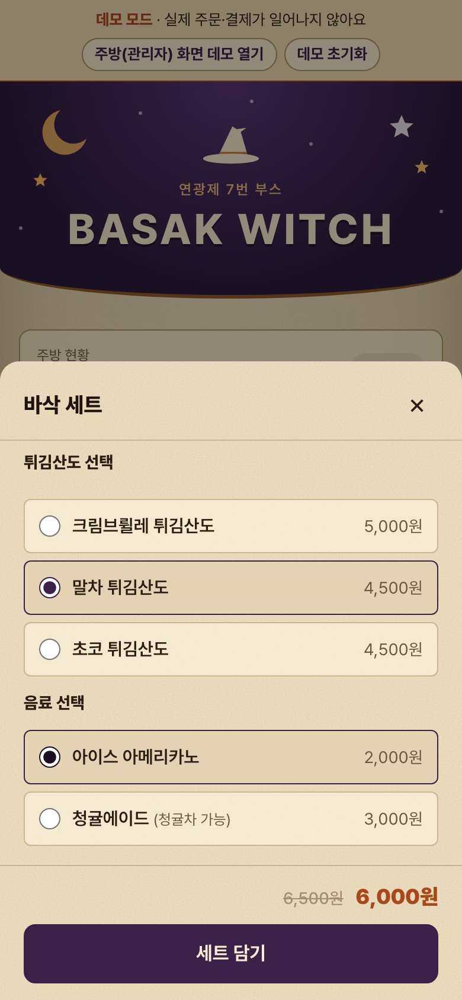
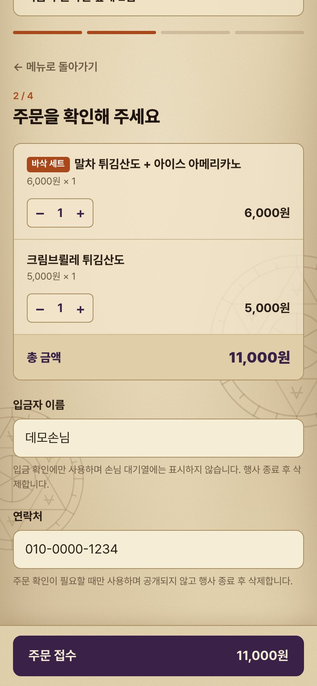
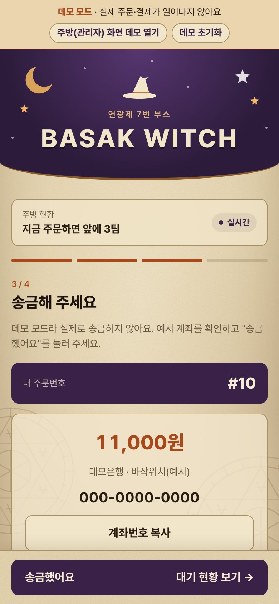
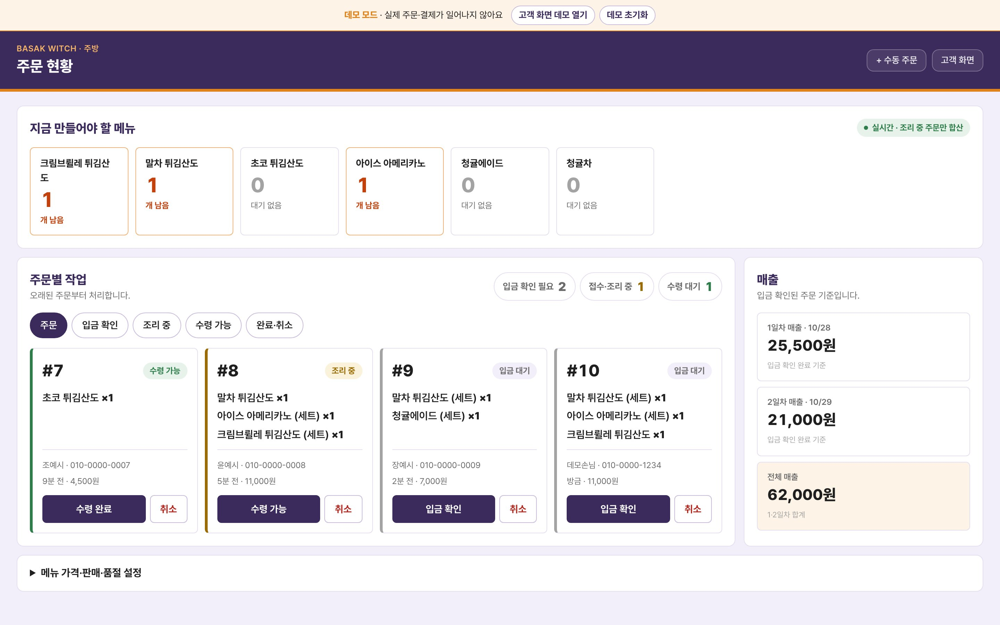
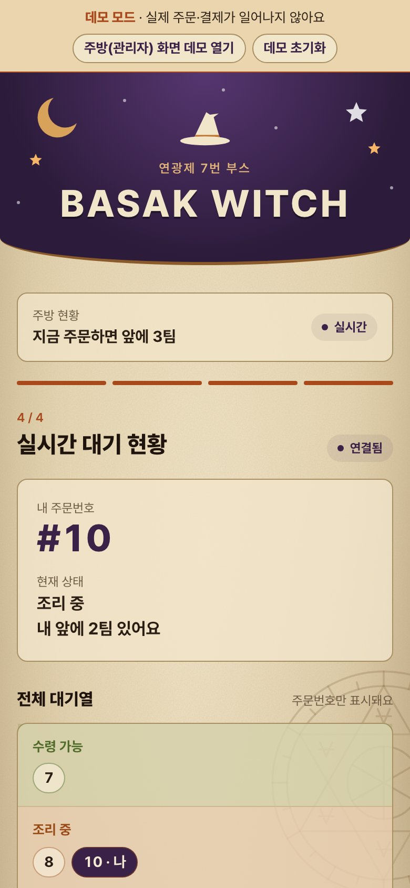
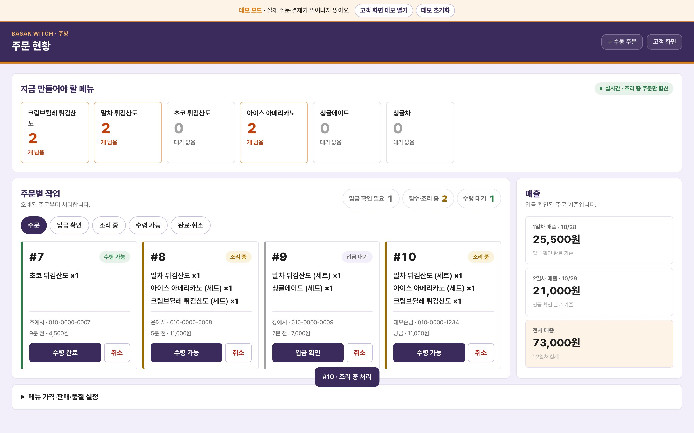
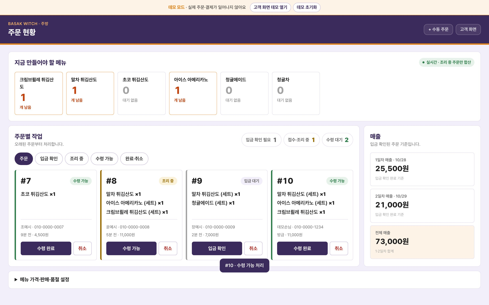

# 부스 QR 주문 관리 시스템

| 화면 | 주소 | 비고 |
| --- | --- | --- |
| 고객(일반) | https://jeong93920.github.io/yeongwang2026/ | 실제 운영 DB에 연결됨 |
| 관리자(주방) | https://jeong93920.github.io/yeongwang2026/admin/ | 관리자 로그인 필요 |
| **데모 고객** | https://jeong93920.github.io/yeongwang2026/?demo | 실제 주문·결제 없음 |
| **데모 관리자** | https://jeong93920.github.io/yeongwang2026/admin/?demo | 로그인 없이 주방 화면 |

처음 보는 분은 **데모 링크**를 쓰세요. 데모는 브라우저 안(localStorage)에서만 동작하고 실제 DB에는 아무것도 보내지 않습니다.

### 30초 사용법 (데모)
1. **데모 고객** 링크를 열고, 위쪽 배너의 `주방(관리자) 화면 데모 열기`로 주방 화면도 엽니다. 두 탭을 나란히 두면 좋습니다.
2. 고객 탭에서 `바삭 세트` → 튀김산도와 음료를 고르고 `세트 담기`, 단품은 `담기`를 누른 뒤 아래 `주문 확인`을 누릅니다.
3. 입금자 이름과 연락처(아무 `010` 번호)를 넣고 `주문 접수` → 송금 화면에서 `송금했어요`를 누르면 대기 현황으로 넘어갑니다.
4. 주방 탭에 새 주문이 `입금 대기`로 들어옵니다. `입금 확인`을 누르면 조리 중, `수령 가능`을 누르면 고객 탭에 소리·팝업 알림이 뜹니다.
5. 주방 탭 맨 아래 `메뉴 가격·판매·품절 설정`에서 품절이나 남은 수량을 바꾸면 고객 메뉴에 바로 반영됩니다.
6. 처음 상태로 돌리려면 배너의 `데모 초기화`를 누릅니다.

| 주방 화면 버튼 | 하는 일 |
| --- | --- |
| `입금 확인` | 송금을 확인하고 바로 조리 시작 |
| `수령 가능` | 조리 완료, 손님 폰에 알림 |
| `수령 완료` | 손님이 받아 감 |
| `취소` | 주문 취소(완료·취소 탭에서 복구 가능) |
| `+ 수동 주문` | 고객 화면을 쓸 수 없을 때 주방에서 직접 주문 입력 |

---

## 1. 제작한 것 소개

학교 축제 **연광제 2026**(10/28~29)에서 운영한 7번 부스 **BASAK WITCH**(튀김산도·음료)의 QR 주문 관리 시스템입니다.
손님은 부스 앞 QR 코드를 찍어 폰으로 주문·송금하고, 부스 안에서는 노트북의 주방 화면으로 주문을 처리합니다.

### 만들게 된 이유
부스를 운영하면서 주문을 종이에 손으로 받아 적고, 입금이 됐는지 하나하나 확인하고, 어느 주문을 먼저 만들지 사람이 직접 챙겨야 했습니다.
손님이 몰리면 주문을 빠뜨리거나 순서가 꼬이기 쉬웠고, 손님은 음식이 언제 나오는지 몰라 부스 앞에서 계속 기다려야 했습니다.
특히 어떤 메뉴가 품절됐는지, 남은 개수가 몇 개인지를 실시간으로 파악하기 어려워서 이미 다 팔린 메뉴를 주문받는 일도 생길 수 있었습니다.

그래서 **손님은 폰으로 직접 주문·송금하고, 주방은 노트북 화면 하나로 입금 확인부터 수령까지 처리하며, 품절과 남은 수량이 손님 화면에 바로 반영되는** QR 주문 관리 시스템을 만들었습니다.

### 주문 진행 단계

| 단계 | 손님 (폰) | 주방 (노트북) |
| :--- | :---: | :---: |
| **① 메뉴 고르기**<br>바삭 세트는 튀김산도와 음료를 고르면 500원 할인 |   | — |
| **② 주문 확인**<br>수량 조절, 입금자 이름·연락처 입력 |  | — |
| **③ 송금**<br>주문번호와 금액을 보고 송금하면, 주방에 `입금 대기` 주문(#10)이 들어옴 |  |  |
| **④ 입금 확인 → 조리 중**<br>주방에서 `입금 확인`을 누르면 손님 대기 현황이 새로고침 없이 바뀜 |  |  |
| **⑤ 수령 가능 → 알림**<br>주방에서 `수령 가능`을 누르면 손님 폰에 소리·진동·팝업 알림 |  |  |

<sub>모두 데모 모드에서 실제로 버튼을 눌러 가며 찍은 화면이며, 이름·연락처는 예시 값입니다.</sub>

### 고객 화면 (`index.html`)
1. **메뉴** — 바삭 세트(튀김산도 + 음료, 500원 할인), 튀김산도 3종, 음료 2종(청귤에이드는 청귤차로 변경 가능). 품절·남은 수량 표시.
2. **주문 확인** — 수량 조절, 입금자 이름·연락처 입력(공개되지 않음).
3. **송금** — 주문번호와 금액, 토스·카카오페이 앱 바로 보내기 또는 계좌번호 복사.
4. **실시간 대기 현황** — 내 주문 상태와 전체 대기열(주문번호만 공개). 주문이 `수령 가능`이 되면 소리·진동·팝업·탭 제목 깜빡임으로 알림.

### 관리자(주방) 화면 (`admin/`)
- **지금 만들어야 할 메뉴**: 조리 중인 주문의 메뉴별 합계(세트도 단품과 합산).
- **주문별 작업**: `입금 확인 → 조리 중 → 수령 가능 → 수령 완료`, 취소·복구, 조리 중 항목 체크.
- **매출**: 1일차(10/28)·2일차(10/29)·전체 매출(입금 확인된 주문 기준).
- **수동 주문**: 서버나 고객 주문 화면에 문제가 생겨 손님이 주문할 수 없을 때를 대비해 `+ 수동 주문` 버튼을 추가했습니다. 직원이 주방 화면에서 직접 주문을 넣으면 바로 조리 중으로 시작합니다.
- **메뉴 설정**: 가격, 남은 수량, 판매 시작·중지, 품절, 세트 할인 금액.

### 기술 구성
- 빌드 없는 정적 HTML/CSS/JS + **Supabase**(PostgreSQL, Auth, Realtime) + **GitHub Pages**.
- 가격·세트 할인·재고 차감은 브라우저가 아니라 DB 함수 `booth_create_order`에서 다시 계산합니다(손님이 금액을 조작할 수 없음).
- 손님에게는 RLS(행 수준 보안)로 메뉴와 공개 대기열(번호·상태)만 보이고, 입금자명·연락처는 관리자만 봅니다.
- 화면 코드는 `window.BoothStore` 인터페이스만 사용합니다. 실제 모드는 `assets/supabase-store.js`, 데모 모드는 `assets/demo-store.js`가 같은 함수를 구현하고, `assets/boot.js`가 주소의 `?demo` 여부로 둘 중 하나를 불러옵니다.

### Supabase 연결과 DB 사용
메뉴·주문·매출 데이터는 모두 **Supabase**(클라우드 PostgreSQL)에 저장하고, 고객 화면과 주방 화면이 같은 DB를 실시간으로 함께 씁니다.

- **연결**: 브라우저에서 `@supabase/supabase-js@2.49.4`로 접속합니다. `assets/supabase-config.js`에는 프로젝트 URL과 공개용 publishable key만 있고, 모든 권한을 가진 Service Role 키는 코드에 넣지 않았습니다.
- **DB 구조 관리**: 테이블·함수·보안 정책·기본 데이터를 마이그레이션 파일 [`supabase/migrations/20261102120000_booth_schema.sql`](supabase/migrations/20261102120000_booth_schema.sql) 하나에 정리했고, Supabase CLI(`npx supabase db push`)로 실제 DB에 적용합니다. 메뉴 교체, 세트 할인, 수동 주문 같은 기능도 마이그레이션으로 DB를 먼저 바꾼 뒤 화면을 배포했습니다. 설치 방법은 [supabase/README.md](supabase/README.md)에 있습니다.

| 테이블 | 저장하는 것 | 누가 읽나 |
| --- | --- | --- |
| `booth_settings` | 부스 이름, 입금 계좌, 영업 여부, 세트 할인 금액 | 누구나 |
| `booth_menu_items` | 메뉴 이름·가격·분류(튀김산도/음료)·대체 메뉴·남은 수량·품절·소요시간 | 누구나(판매 중인 것만) |
| `booth_orders` | 주문번호, 입금자명, 연락처, 상태, 금액 | 관리자만 |
| `booth_order_items` | 주문별 메뉴 줄(이름·가격·수량 기록) | 관리자만 |
| `booth_public_queue` | 대기열에 공개할 주문번호와 상태만 | 누구나 |
| `booth_admins` | 관리자 계정 | 관리자 확인용 |

| DB 함수(RPC) | 하는 일 |
| --- | --- |
| `booth_create_order` | 손님 주문 생성. 메뉴 가격·세트 할인을 DB에서 다시 계산하고, 남은 수량을 잠가 차감 |
| `booth_get_order` | 기기에 저장된 비밀 토큰으로 내 주문만 다시 불러오기 |
| `booth_admin_create_order` | 주방에서 넣는 수동 주문(관리자만, 바로 조리 중) |
| `booth_is_admin` | 로그인한 계정이 관리자인지 확인 |
| `booth_sync_public_queue` (트리거) | 주문이 생기거나 상태가 바뀌면 공개 대기열을 자동 갱신 |

- **실시간(Realtime)**: `booth_public_queue`의 변경을 구독해서, 주방에서 `수령 가능`을 누르면 손님 폰 화면이 새로고침 없이 바뀌고 수령 알림이 뜹니다.
- **로그인(Auth)**: 관리자는 Supabase Auth로 로그인하고, `booth_admins`에 등록된 계정만 주문·메뉴를 바꿀 수 있습니다.
- **보안(RLS)**: 행 수준 보안 정책으로 손님은 메뉴와 공개 대기열만 읽을 수 있고, 주문 테이블을 직접 읽거나 쓸 수 없습니다. 주문은 위 DB 함수를 통해서만 만들어집니다.

### 어떻게 동작하나

**주문 상태 흐름**
```
손님 주문 ─▶ 입금 대기 ─(입금 확인)─▶ 조리 중 ─(수령 가능)─▶ 수령 가능 ─(수령 완료)─▶ 수령 완료
주방 수동 주문 ───────────────────▶ 조리 중
어느 단계에서든 ─(취소)─▶ 취소
```

**가격 계산** — 브라우저가 보낸 금액은 쓰지 않고, DB 함수 `booth_create_order`가 메뉴 표의 가격으로 다시 계산합니다.
- 단품: 가격 × 수량. 청귤에이드를 청귤차로 바꾸면 이름만 바뀝니다.
- 바삭 세트: 튀김산도 + 음료 − 세트 할인(기본 500원). 주방에서 메뉴별로 셀 수 있게 `말차 튀김산도 (세트)`, `아이스 아메리카노 (세트)` 두 줄로 저장하고, 할인은 음료 줄에서 먼저 뺍니다.

**재고와 품절** — 남은 수량이 정해진 메뉴는 주문할 때 메뉴 행을 잠그고 수량을 확인한 뒤 뺍니다. 0개가 되면 자동으로 품절이 되고, 남은 수량보다 많이 주문하면 "○개만 남았습니다"로 거절합니다. 주방에서 남은 수량을 0으로 저장해도 품절, 비워 두면 제한이 없습니다.

**실시간 반영** — 손님·주방 화면 모두 공개 대기열 테이블의 변경을 Supabase Realtime으로 구독하다가, 바뀌면 곧바로 데이터를 다시 불러옵니다. 손님 화면은 주문을 기다리는 동안 20초마다 한 번 더 확인하고, 다른 앱을 쓰다 돌아왔을 때도 다시 불러옵니다.

**내 주문 복구** — 주문하면 추측할 수 없는 토큰을 받아 폰에 저장합니다. 새로고침하거나 창을 닫았다 열어도 이 토큰으로 내 주문만 다시 불러오고, 다른 사람의 주문 내용은 볼 수 없습니다.

**데모 모드** — `assets/boot.js`가 주소에 `?demo`가 있으면 Supabase 대신 `assets/demo-store.js`를 불러옵니다. 데모 저장소는 실제 저장소와 같은 함수를 같은 계산 규칙으로 구현하고, localStorage에 저장한 뒤 브라우저의 `storage` 이벤트로 고객 탭과 주방 탭을 맞춥니다.

### 축제 결과
이틀 동안 실제로 이 앱으로 주문을 받았습니다. 입금 확인된 주문만 세면 **225건, 419개, 1,917,000원**입니다(10/29 21시 집계, 취소·입금 대기 주문 제외).

| | 주문 | 판매 개수 | 매출 |
| --- | --- | --- | --- |
| 1일차 (10/28) | 113건 | 229개 | 1,067,000원 |
| 2일차 (10/29) | 112건 | 190개 | 850,000원 |
| 합계 | 225건 | 419개 | 1,917,000원 |

### 로컬 실행
```bash
python3 -m http.server 4173 --bind 127.0.0.1
```
- 데모 고객: http://127.0.0.1:4173/?demo · 데모 관리자: http://127.0.0.1:4173/admin/?demo
- `?demo` 없이 열면 실제 Supabase에 연결됩니다. **실제 주소에서는 테스트 주문을 넣지 마세요.**
- 자동 테스트는 아래 [6. 테스트](#6-테스트)를 보세요.

---

## 2. PRD와 Todo 리스트

전체 문서: [docs/PRD.md](docs/PRD.md) · [docs/TODO.md](docs/TODO.md)

### PRD (요약)

**목표**
1. 손님이 앱 설치나 회원가입 없이 폰 브라우저만으로 주문·송금을 마친다.
2. 주방은 화면 하나로 입금 확인 → 조리 → 수령까지 주문을 처리한다.
3. 손님은 주문 상태와 대기 순서를 실시간으로 보고, 준비되면 알림을 받는다.
4. 운영 중에도 가격·품절·남은 수량·세트 할인을 화면에서 바로 바꾼다.

**사용자**

| 사용자 | 기기 | 하는 일 |
| --- | --- | --- |
| 손님 | 자기 폰(브라우저) | QR 접속 → 메뉴 선택 → 주문 → 송금 → 대기·수령 |
| 부스 운영자(주방) | 노트북 | 관리자 로그인 → 입금 확인 → 조리 → 수령 처리, 메뉴·재고 관리, 매출 확인 |

**기능 요구사항**

| 우선순위 | 화면 | 기능 | 설명 |
| --- | --- | --- | --- |
| P0 | 고객 | 메뉴 보기 | 세트·튀김산도·음료 구역, 가격, 품절·남은 수량 표시 |
| P0 | 고객 | 세트·옵션 선택 | 세트는 튀김산도 맛과 음료를 고르고 할인 적용, 청귤에이드는 청귤차로 변경 가능 |
| P0 | 고객 | 주문 | 수량 조절, 입금자 이름·연락처 입력, 주문번호 발급 |
| P0 | 고객 | 송금 | 주문 금액이 들어간 토스 송금 링크, 카카오페이, 계좌번호 복사 |
| P0 | 고객 | 실시간 대기 현황 | 내 주문 상태, 내 앞 대기 팀 수, 전체 대기열(주문번호만 공개) |
| P0 | 관리자 | 로그인 | 등록된 관리자 계정만 접근 |
| P0 | 관리자 | 주문 처리 | 입금 확인 → 조리 중 → 수령 가능 → 수령 완료, 취소·복구 |
| P0 | 관리자 | 지금 만들 메뉴 | 조리 중 주문의 메뉴별 합계(세트 구성품 포함) |
| P0 | 공통 | 서버 계산 | 가격·세트 할인·재고 차감은 DB 함수에서 다시 계산 |
| P1 | 고객 | 수령 알림 | `수령 가능`이 되면 소리·진동·팝업·탭 제목 깜빡임 |
| P1 | 관리자 | 메뉴 설정 | 가격, 남은 수량, 판매 시작·중지, 품절, 소요시간, 세트 할인 금액 |
| P1 | 관리자 | 매출 | 1일차·2일차·전체 매출(입금 확인된 주문 기준) |
| P1 | 관리자 | 조리 중 항목 체크 | 주문 안의 메뉴를 하나씩 눌러 완료 표시 |
| P2 | 관리자 | 수동 주문 | 고객 화면을 쓸 수 없을 때 주방에서 직접 주문 입력 |
| P2 | 공통 | 데모 모드 | `?demo` 주소로 실제 DB 없이 고객·주방 화면을 모두 체험 |

**범위 밖**
- 문자·카카오 알림톡 발송(업체 가입과 발신번호 등록이 필요해 화면 알림으로 대신한다)
- 카드 결제·PG 연동
- 손님 회원가입·로그인

### Todo 리스트

#### 1단계 — 운영 환경 준비
- [x] 새 Supabase 프로젝트를 만들고 DB 마이그레이션 적용 (`80dc7ca`)
- [x] 앱 설정을 Supabase 프로젝트에 연결하고 GitHub Pages로 배포 (`80dc7ca`)
- [x] 관리자 계정 등록 (`4dc22d1`, `d282abc`)
- [x] 관리자: 메뉴 남은 수량 편집 (`fa78aec`)
- [x] 관리자: 주문 흐름 단순화(입금 확인 → 조리 중), 주문 탭 하나로 (`a933e93`)
- [x] 관리자: 1·2일차 매출 나누기 (`f4b276d`)
- [x] 관리자: 조리 중 주문의 메뉴 항목 하나씩 체크 (`eb99529`)

#### 2단계 — 주문 화면과 메뉴
- [x] 고객 주문 화면 — 메뉴 → 주문 확인(이름·연락처) → 송금 → 실시간 대기 현황 4단계 (`ac47528`)
- [x] 관리자 주방 화면 — 주문별 작업, 지금 만들 메뉴, 매출, 메뉴 설정 (`ac47528`)
- [x] 두 화면에 BASAK WITCH 부스 디자인 적용 (`ac47528`)
- [x] 메뉴별 재고 계산 정리, 화면 오류 수정 (`ac47528`)
- [x] 부스명과 메뉴 DB 마이그레이션 (`ac47528`)

#### 3단계 — 메뉴 확정, 세트, 알림
- [x] 메뉴 교체와 세트 할인(DB 함수 수정) (`4c25fce`)
- [x] 세트·옵션 선택 창 — 튀김산도·음료 고르기, 청귤차 변경 (`4c25fce`)
- [x] 관리자에서 세트 할인 금액 설정 (`4d3cf4a`)
- [x] 수령 가능 알림(소리·진동·팝업·탭 제목) (`38501f6`)
- [x] 관리자 화면 단순화(만들 메뉴 합계, 상태별 개수) (`6b9ac4f`)

#### 4단계 — 축제 준비
- [x] 실제 입금 계좌, 부스 번호, 최종 메뉴 이름 반영 (`fb81592`)
- [x] 고객 주문 QR 코드와 포스터
- [x] 장사 전 테스트 주문 초기화

#### 5단계 — 축제 당일 보강
- [x] 고객 주문 화면이 안 될 때를 대비한 관리자 `+ 수동 주문` 버튼(DB 함수 추가) (`7cdf247`)
- [x] 세트 선택창 품절 표시 (`7cdf247`)

---

## 3. Todo 리스트 변경 내역

처음 계획과 달라진 항목입니다(수정한 것, 테스트 후 바뀐 것, 뺀 것, 새로 넣은 것). 같은 표가 [docs/TODO.md](docs/TODO.md)에도 있습니다.

| 단계 | 처음 계획 | 바뀐 결과 | 이유 |
| --- | --- | --- | --- |
| 1단계 | 관리자에 "고객에게 수량 표시" 설정 추가 | **뺌** — 설정과 DB 컬럼을 지우고 남은 수량은 항상 표시 | 설정 화면을 보고 필요 없다고 판단 |
| 1단계 | 입금 확인 → 주문 접수 → 조리 중 | **수정** — 주문 접수 단계를 빼고 입금 확인 시 바로 조리 중 | 부스에서는 단계를 줄이는 편이 빠름 |
| 2단계 | 가격 미정 메뉴는 판매 중지 상태로 등록 | **테스트 후 변경** — 임시 가격을 넣어 화면에 보이게 함 | 가격 0·판매 중지면 손님 화면에 메뉴가 하나도 안 보임 |
| 3단계 | 세트 할인 500원 고정 | **수정** — 관리자 화면에서 할인 금액 설정 | 운영 중에 바꿀 수 있어야 함 |
| 3단계 | 문자로 수령 알림 | **뺌** — 화면 알림(소리·진동·팝업)만 | 문자는 업체 가입과 발신번호 등록이 필요 |
| 3단계 | (없음) | **추가** — 수령 가능 알림 | 손님이 부스 앞에서 기다리지 않게 |
| 5단계 | (없음) | **추가** — 관리자 수동 주문, 세트 선택창 품절 표시 | 고객 화면이 안 될 때를 대비 |
| 5단계 | 수동 주문에 입금 여부 체크박스 | **수정** — 체크박스를 없애고 항상 조리 중으로 시작 | 운영하면서 더 단순하게 쓰기로 함 |

---

## 4. 스킬 (Claude Code Skills)

축제를 운영하면서 같은 작업을 여러 번 반복했습니다. 장사 전에 테스트 주문을 지우는 일, 그날 무엇이 몇 개 팔렸는지 세는 일, 메뉴·계좌·할인을 바꿀 때마다 DB를 먼저 바꾸고 화면을 배포하는 일입니다.
매번 대화로 처음부터 설명하면 순서를 빠뜨리기 쉬웠습니다(예: 마이그레이션 파일만 만들고 DB에 적용하지 않아 메뉴가 안 바뀐 일). 그래서 **실제로 쓴 SQL과 명령을 그대로 스킬로 만들어** 저장소의 `.claude/skills/`에 두었습니다.

Claude Code에서 `/reset-orders`, `/sales-report`, `/release`로 부르거나, "주문 목록 초기화해줘", "오늘 메뉴별로 몇 개 팔렸어?", "메뉴 바꿔서 배포해줘"처럼 말하면 스킬 설명을 보고 Claude가 알아서 불러옵니다.

| 스킬 | 언제 쓰나 | 들어 있는 파일 |
| --- | --- | --- |
| `reset-orders` | 장사 전 테스트 주문 정리, 다음 날 주문번호를 1번부터 | `SKILL.md`, `sql/peek.sql`, `sql/backup.sql`, `sql/wipe.sql`, `sql/reseq.sql` |
| `sales-report` | 일차별·메뉴별 판매 개수와 매출 집계 | `SKILL.md`, `sql/sales-by-day.sql`, `sql/excluded.sql` |
| `release` | DB와 화면을 함께 바꾸는 변경 배포 | `SKILL.md` |

### 4-1. `reset-orders` — 주문 목록 초기화
**만든 이유**: 축제 직전과 1일차 새벽에 테스트 주문을 네 번 지웠습니다(10/26, 10/28 0시·1시 전후). 실제 운영 DB를 지우는 일이라 매번 "무엇을 지우는지 확인 → 백업 → 한 번에 삭제 → 주문번호 1번부터 → 확인" 순서를 정확히 지켜야 했습니다.

**내용**
1. `peek.sql`로 지울 주문의 건수·상태·시각을 먼저 보여 주고, 입금 확인된 실제 주문이 섞여 있으면 멈춥니다.
2. `backup.sql`로 주문과 주문 항목 전체를 JSON으로 받아 **저장소 밖** 폴더에 저장합니다(손님 이름·연락처가 들어 있음).
3. `wipe.sql`이 한 트랜잭션 안에서 주문 항목 → 대기열 → 주문을 지우고 `order_number`를 1번부터 다시 시작합니다. 메뉴·가격·설정은 건드리지 않습니다.
4. 세 테이블이 0건이고 다음 번호가 1번인지 확인합니다. 읽기는 `--read-only`, 삭제는 사용자가 확인한 뒤에만 `--yes`로 실행합니다.

**실제 사용**: `sql/` 안의 SQL은 축제 때 테스트 주문을 정리하며 실제로 실행한 것과 같습니다. 예를 들어 10/26에는 테스트 주문 28건(주문 항목 48개)을 백업한 뒤 지웠고, 검증 결과 다음 주문이 #1로 시작했습니다.

<details><summary><code>reset-orders/SKILL.md</code> 전체 보기</summary>

~~~~markdown
---
name: reset-orders
description: BASAK WITCH 부스 주문 관리 시스템의 실제 Supabase DB에서 주문 목록을 초기화하는 절차. 주문을 확인하고, 백업하고, 주문·주문 항목·대기열을 지운 뒤 주문번호를 1번부터 다시 시작한다. "주문 목록 초기화", "주문 다 지워줘", "주문번호 1번부터", "테스트 주문 정리" 같은 요청에 사용한다.
---

# reset-orders — 주문 목록 초기화

장사 전 테스트 주문을 정리하거나, 다음 날 장사를 새로 시작할 때 쓴다.
**실제 운영 DB의 데이터를 지우는 작업**이므로 사용자가 직접 요청했을 때만 하고, 지우기 전에 반드시 무엇을 지우는지 보여 준다.

준비: 저장소 루트에서 실행하고, Supabase CLI가 이 프로젝트에 연결(`supabase link`)되어 있어야 한다.
SQL 파일은 이 스킬 폴더의 `sql/`에 있다.

```bash
Q=".claude/skills/reset-orders/sql"
BACKUP_DIR="$HOME/연광제/backups"   # 저장소 밖. 손님 이름·연락처가 들어 있으므로 절대 커밋하지 않는다
mkdir -p "$BACKUP_DIR"
```

## 1. 지울 주문 확인
```bash
TZ=Asia/Seoul date '+%m-%d %H:%M'
npx -y supabase@latest db query --linked --read-only -f $Q/peek.sql
```
- 주문 건수, 상태, 시각을 사용자에게 알려 준다.
- 장사 중이면 **테스트 주문인지** 확인한다. 입금 확인된 실제 주문(`cooking`, `ready`, `picked_up`)이 섞여 있으면 멈추고 다시 물어본다. 지우면 매출 집계에서도 사라진다.

## 2. 백업
```bash
npx -y supabase@latest db query --linked --read-only -f $Q/backup.sql > "$BACKUP_DIR/orders-backup-$(TZ=Asia/Seoul date +%m%d-%H%M).json" 2>/dev/null
```
- 파일 안의 `orders`, `items`, `queue` 건수가 1단계에서 본 건수와 같은지 확인한다. 다르면 지우지 않는다.

## 3. 삭제와 주문번호 초기화
```bash
npx -y supabase@latest db query --linked --yes -f $Q/wipe.sql 2>&1 | grep -E '"(orders|items|queue|seq_last|seq_called)"|rror'
```
- 주문 항목 → 공개 대기열 → 주문 순서로 한 트랜잭션 안에서 지우고, `order_number`를 1번부터 다시 시작한다.
- 메뉴·가격·계좌·세트 할인 설정은 건드리지 않는다.

## 4. 검증
- `orders`, `items`, `queue`가 모두 `0`이고 `seq_last = 1`, `seq_called = false`이면 다음 주문이 **#1**이 된다.
- 주방 화면을 새로고침해 주문이 비었는지 사용자에게 확인을 부탁한다.

## 주문번호만 1번으로 되돌릴 때
주문 함수를 실제 DB에서 `begin … rollback`으로 시험하면 주문은 남지 않아도 주문번호는 소모된다. 주문이 0건일 때만:
```bash
npx -y supabase@latest db query --linked --yes -f $Q/reseq.sql
```
주문이 남아 있으면 오류를 내고 아무것도 바꾸지 않는다.

## 주의
- Supabase CLI는 실제(production) DB에 쿼리할 때 확인을 요구한다. 읽기만 하는 1·2단계는 `--read-only`, 데이터를 바꾸는 3단계와 `reseq.sql`은 **사용자가 1단계 결과를 보고 지워도 된다고 답한 뒤에만** `--yes`를 붙여 실행한다.
- 백업 파일은 저장소 밖(`~/연광제/backups/`)에만 둔다. 손님 이름·연락처가 들어 있다.
- `npx -y supabase@latest`는 실행할 때마다 CLI를 내려받아 1분 가까이 걸린다. 여러 번 실행할 일이 있으면 CLI를 한 번 설치해 두고 `supabase db query --linked`로 쓴다.
- 프로젝트가 일시정지(INACTIVE) 상태면 쿼리가 실패한다. 대시보드에서 먼저 복원한다.
~~~~

</details>

### 4-2. `sales-report` — 일차별·메뉴별 판매 집계
**만든 이유**: 1일차 저녁과 2일차 마감 뒤 "메뉴별로 몇 개 팔렸는지, 이틀 합계가 얼마인지"를 정리했습니다. 관리자 화면에는 일차별 매출 합계만 있어서, 메뉴별 개수는 DB에서 따로 세야 했습니다. 세트 줄 합치기, 취소·입금 대기 제외, 한국 시간 기준 날짜 같은 규칙을 매번 똑같이 적용해야 숫자가 관리자 화면과 맞습니다.

**내용**
- 입금 확인 이후 상태(`confirmed`·`cooking`·`ready`·`picked_up`)만 매출로 세고, 취소·입금 대기는 `excluded.sql`로 따로 보여 줍니다.
- 주문 시각을 한국 시간 날짜로 바꿔 일차를 나누고, `말차 튀김산도 (세트)` 같은 세트 줄은 단품과 합쳐 셉니다(세트로 팔린 개수는 따로 표시).
- 메뉴별 금액 합과 주문 금액 합이 같은지 확인한 뒤 메뉴 × 일차 표로 정리합니다. 손님 이름·연락처는 출력하지 않습니다.

**실제 사용**: 1장 **축제 결과** 표(225건, 419개, 1,917,000원)가 이 집계 규칙으로 10/29 마감 뒤 정리한 숫자입니다.

<details><summary><code>sales-report/SKILL.md</code> 전체 보기</summary>

~~~~markdown
---
name: sales-report
description: BASAK WITCH 부스 주문 관리 시스템의 실제 Supabase DB에서 일차별·메뉴별 판매 개수와 매출을 집계해 표로 정리하는 절차. "오늘 몇 개 팔렸어", "메뉴별 판매 개수", "1일차 2일차 매출", "총합 정리" 같은 요청에 사용한다. 읽기 전용이다.
---

# sales-report — 일차별·메뉴별 판매 집계

장사 중간이나 끝난 뒤 "무엇이 몇 개 팔렸고 얼마 벌었는지"를 정리할 때 쓴다. DB를 읽기만 한다.

준비: 저장소 루트에서 실행하고, Supabase CLI가 이 프로젝트에 연결되어 있어야 한다.

```bash
Q=".claude/skills/sales-report/sql"
npx -y supabase@latest db query --linked --read-only -f $Q/sales-by-day.sql 2>/dev/null
npx -y supabase@latest db query --linked --read-only -f $Q/excluded.sql 2>/dev/null
```

## 집계 규칙 (관리자 화면 매출과 같은 기준)
- **매출에 넣는 주문**: 입금 확인 이후 상태(`confirmed`, `cooking`, `ready`, `picked_up`)만. `payment_pending`(입금 대기)과 `cancelled`(취소)는 `excluded.sql`로 따로 보여 준다.
- **일차**: 주문 시각을 **한국 시간** 날짜로 바꿔 나눈다. 연광제는 10/28 = 1일차, 10/29 = 2일차.
- **세트**: `말차 튀김산도 (세트)`처럼 저장된 세트 줄은 `(세트)`를 떼고 단품과 합쳐 센다. 세트로 팔린 개수는 `in_set` 열에 따로 나온다.
- **대체 메뉴**: 청귤차는 청귤에이드와 합치지 않고 따로 센다.
- **금액**: 메뉴별 금액은 `수량 × 저장된 가격`이고, 세트 음료는 할인이 반영된 가격이다. 일차 합계는 주문의 `total_amount` 합이다. 둘의 합이 같은지 확인한다.

## 결과 정리
1. 결과의 `rows` JSON에서 `kind = 'item'` 줄을 일차별로 모아 표로 만든다.

   | 메뉴 | 1일차 | 2일차 | 합계 |
   | --- | --- | --- | --- |
   | 크림브륄레 튀김산도 | ○개 · ○원 | … | … |

2. 마지막에 일차별 주문 건수(`kind = 'total'`)와 매출, 전체 합계를 쓴다.
3. 취소·입금 대기 건수와 금액은 "매출에서 뺀 주문"으로 한 줄 덧붙인다.
4. 관리자 화면의 1·2일차 매출과 숫자가 다르면, 날짜를 한국 시간으로 바꿨는지와 상태 조건을 먼저 확인한다.

## 주의
- 항상 `--read-only`로 실행한다. 집계는 DB를 바꿀 일이 없고, 이 옵션이 없으면 CLI가 실제 DB 쿼리 확인을 요구한다.
- 결과에 손님 이름·연락처는 나오지 않는다. 다른 쿼리를 덧붙일 때도 `payer_name`, `contact`는 출력하지 않는다.
- `npx -y supabase@latest`는 실행할 때마다 CLI를 내려받아 느리다. 자주 볼 때는 CLI를 설치해 두고 `supabase db query --linked`로 쓴다.
~~~~

</details>

### 4-3. `release` — DB 먼저, 화면은 나중에 배포
**만든 이유**: 화면 코드가 새 DB 컬럼·함수를 바로 읽기 때문에 순서가 중요했습니다. 실제로 마이그레이션 파일만 만들고 DB에 적용하지 않아 메뉴가 안 바뀐 일, Supabase 프로젝트가 일시정지돼 DB 변경이 막힌 일, 폰 브라우저 캐시 때문에 예전 화면이 보인 일이 있었습니다.

**내용**
1. Supabase 프로젝트가 일시정지 상태가 아닌지 확인합니다.
2. 마이그레이션을 쓰고, 주문 함수를 바꿨다면 실제 DB에서 `begin … rollback`으로 미리 시험합니다.
3. `db push --dry-run`으로 이번 파일만 적용되는지 본 뒤 적용하고, 바뀐 값을 읽기 전용 쿼리로 확인합니다.
4. 화면 파일의 `?v=` 캐시 버전을 올리고 `npm test`로 흐름을 확인한 뒤 push → GitHub Pages 배포 완료 → 실제 사이트에 새 버전이 반영됐는지 확인합니다.

**실제 사용**: 메뉴·세트 할인 도입(`4c25fce`), 세트 할인 설정(`4d3cf4a`), 실제 계좌·메뉴 이름 반영(`fb81592`), 수동 주문 함수 추가(`7cdf247`)를 이 순서로 배포했습니다.

<details><summary><code>release/SKILL.md</code> 전체 보기</summary>

~~~~markdown
---
name: release
description: BASAK WITCH 부스 주문 관리 시스템에서 DB(Supabase)와 화면(GitHub Pages)을 함께 바꾸는 변경을 배포하는 절차. 메뉴·가격·계좌·세트 할인 변경, 새 DB 함수(RPC) 추가처럼 마이그레이션이 필요한 작업에 쓴다. "배포해줘", "메뉴 바꿔서 올려줘", "DB 바꾸고 배포" 같은 요청에 사용한다.
---

# release — DB 먼저, 화면은 나중에 배포하기

화면 코드는 새 DB 컬럼·함수를 바로 읽기 때문에, **DB를 먼저 바꾸고 확인한 뒤에 화면을 배포**해야 한다.
순서가 거꾸로면 실제 사이트에서 메뉴가 안 뜨거나 주문이 실패한다.

## 1. Supabase 상태 확인
```bash
npx -y supabase@latest projects list 2>&1 | grep -o '"status":"[A-Z_]*"'
```
- `INACTIVE`(일시정지)면 CLI로는 풀 수 없다. 사용자에게 대시보드에서 **Restore project**를 눌러 달라고 하고, `ACTIVE_HEALTHY`가 될 때까지 화면은 커밋만 하고 push하지 않는다.

## 2. 마이그레이션 작성
- `supabase/migrations/YYYYMMDDHHMMSS_설명.sql` — 마지막 파일보다 큰 타임스탬프로 만든다.
- **파일을 만드는 것만으로는 DB가 바뀌지 않는다.** 반드시 4단계까지 진행한다.
- 메뉴를 판매 상태로 올릴 때는 가격이 0보다 커야 한다(`not active or price > 0`). 가격 0원 메뉴는 손님 화면에 나오지 않는다.

## 3. 주문 함수를 바꿨다면 실제 DB에서 미리 시험
```bash
{ echo "begin;"; cat supabase/migrations/<이번 파일>.sql; cat test.sql; echo "rollback;"; } > /tmp/try.sql
npx -y supabase@latest db query --linked --yes -f /tmp/try.sql   # 사용자에게 시험 실행을 알린 뒤
```
- `test.sql`에는 `select * from public.booth_create_order(...)`처럼 함수를 불러 금액을 확인하는 쿼리를 넣는다. `rollback`으로 끝나므로 주문은 남지 않는다.
- 시험 뒤에는 주문번호가 소모되므로, 장사 전이라면 `reset-orders` 스킬의 `reseq.sql`로 1번으로 되돌린다.

## 4. 적용
```bash
npx -y supabase@latest db push --remote --dry-run 2>&1 | tail -8   # 이번 파일만 적용 대상인지 확인
yes | npx -y supabase@latest db push --remote 2>&1 | tail -6       # "Finished supabase db push" 확인
```
적용 뒤 바뀐 값을 `--read-only` 쿼리로 확인한다(예: `select name, price, active from booth_menu_items order by sort_order;`).

## 5. 화면 캐시 버전 올리기
바뀐 JS·CSS를 불러오는 `?v=` 값을 새 날짜시각으로 바꾼다. 올리지 않으면 손님 폰이 예전 파일을 계속 쓴다.
```bash
grep -n '?v=' index.html admin/index.html
```
`boot.js`의 `data-store`·`data-demo`·`data-page` 속성 안의 `?v=`도 함께 바꾼다. 데모 모드도 같은 화면 코드를 쓰므로 `npm test`로 흐름이 깨지지 않았는지 확인한다.

## 6. 배포와 확인
```bash
git add <바꾼 파일> && git commit && git push origin main
# main 브랜치 배포 빌드가 끝날 때까지 확인(built가 나오면 완료, errored면 실패)
until s=$(gh api repos/jeong93920/yeongwang2026/pages/builds/latest --jq '.status'); [ "$s" = built ] || [ "$s" = errored ]; do sleep 10; done; echo "$s"
curl -s "https://jeong93920.github.io/yeongwang2026/?x=$RANDOM" | grep -c '<새 ?v 값>'
```
- GitHub Pages는 main 브랜치를 그대로 배포한다(별도 배포 워크플로 없음). push 뒤 1분 안팎이면 빌드가 끝난다.
- `0`이 나오면 Pages 반영이 늦은 것이니 잠시 뒤 다시 확인한다.
- 마지막으로 폰으로 고객 화면을 열어 메뉴와 가격이 바뀌었는지 사용자에게 확인을 부탁한다.

## 주의
- 실제 주소(`?demo` 없음)에서는 테스트 주문을 넣지 않는다. 화면 확인은 데모 모드로 한다.
- Service Role 키는 화면 코드에 넣지 않는다. 브라우저에는 publishable key만 둔다.
~~~~

</details>

---

## 5. 느낀 점과 결론

- **직접 써 봐야 보이는 것이 많았다.** 화면 위의 코드는 맞아 보여도, 폰으로 열어 보면 "요"나 "도" 한 글자가 다음 줄로 넘어가거나 버튼이 겹쳤다. 고친 것의 상당수가 폰으로 직접 확인하고 다시 요청한 것이었다.
- **AI에게는 무엇을 원하는지 정확히 말해야 한다.** "아이콘을 마녀로"를 헤더 그림으로 이해한 것처럼, 짧은 요청은 다르게 해석될 수 있었다. 고칠 위치와 이유를 같이 말하면 한 번에 맞는 경우가 많았다.
- **실제 운영은 코드 밖의 일도 많다.** Supabase 프로젝트 일시정지, 캐시 때문에 예전 화면이 보이는 문제처럼 기능이 아닌 문제에 시간이 많이 들었다. 그래서 축제 동안 여러 번 반복한 주문 초기화, 매출 집계, 배포 절차는 스킬로 정리해 두었다.
- **현장에서는 기능을 더하는 것보다 단계를 줄이는 것이 중요했다.** 처음에는 `입금 확인 → 주문 접수 → 조리 중`으로 나눴지만, 부스에서는 버튼을 한 번이라도 덜 누르는 편이 빨라서 주문 접수 단계를 뺐다. 수동 주문의 입금 여부 체크박스, 손님에게 수량을 보여 줄지 고르는 설정도 같은 이유로 없앴다. 계획할 때 필요해 보이던 것이 실제로 써 보면 필요 없는 경우가 많았다.
- **안 될 때를 대비한 방법이 있어야 마음 놓고 운영할 수 있다.** 모든 주문이 손님 폰을 통해서만 들어오면 서버나 화면에 문제가 생기는 순간 장사가 멈춘다. 축제 첫날 주방 화면에 `+ 수동 주문` 버튼을 추가한 것도 그래서였다. 문제가 생겨도 주문을 계속 받을 수 있는 방법을 미리 만들어 두는 것이 새 기능보다 중요했다.
- **순서를 규칙으로 정해 두면 같은 실수를 줄일 수 있다.** 마이그레이션 파일만 만들고 DB에 적용하지 않아 메뉴가 안 바뀐 일을 겪은 뒤, **DB 먼저, 화면 배포는 나중**을 규칙으로 정하고 `release` 스킬에 그 순서를 적어 두었다. 한 번 겪은 실수를 기억에 맡기지 않고 절차로 남겨 두면, 다음에 배포할 때 같은 순서를 그대로 따를 수 있다.
- **실제 데이터를 건드리지 않고 확인할 수 있는 환경이 필요했다.** 운영 중인 DB에 테스트 주문을 넣으면 주문번호와 매출이 섞인다. 그래서 브라우저 안에서만 도는 데모 모드를 만들고, 자동 테스트도 데모 모드로 돌렸다. 덕분에 실제 주문에 영향을 주지 않고 고객 화면과 주방 화면을 함께 확인할 수 있었다.

### 결론

이 앱으로 연광제 이틀 동안 실제 주문 **225건, 419개, 1,917,000원**어치를 받았다. 종이에 주문을 받아 적고 입금을 하나하나 확인하던 일을, 손님은 폰으로 주문·송금하고 주방은 노트북 화면 하나로 처리하는 방식으로 바꿨다. 손님은 수령 알림을 받을 때까지 부스 앞에서 기다리지 않아도 됐고, 품절과 남은 수량이 바로 반영돼 이미 다 팔린 메뉴를 주문받는 일도 막을 수 있었다.

바이브 코딩으로도 실제로 쓰이는 서비스를 만들 수 있었다. 하지만 무엇을 만들지 정하고, 폰으로 직접 열어 확인하고, 현장에 맞게 단계를 줄이거나 빼는 판단은 결국 사람의 몫이었다. AI는 빠르게 만들어 주는 도구였고, 좋은 결과는 내가 얼마나 정확히 요청하고 꼼꼼히 확인하느냐에 달려 있었다.

다음에 다시 만든다면 [8. 한계](#8-한계)에 적은 부분부터 보완하고 싶다. 입금을 사람이 눈으로 확인하지 않아도 되는 자동 입금 확인, 화면을 닫아도 오는 푸시 알림, 주방 기기마다 따로 쓰는 관리자 계정이 있으면 더 큰 부스나 다른 행사에서도 쓸 수 있을 것이다.

---

## 6. 테스트

```bash
npm install && npx playwright install chromium
npm test              # 데모 모드 브라우저 동작 테스트 15건
npm run screenshots   # 테스트하면서 README 단계별 스크린샷도 다시 찍기
```

`tests/e2e.test.mjs`가 저장소 폴더를 작은 정적 서버로 띄우고, 헤드리스 크롬으로 **고객 화면(폰 390px)과 주방 화면(노트북 1440px)을 함께 열어 실제 버튼을 눌러 가며** 확인합니다.
실제 Supabase에는 접속하지 않으며(데모 모드), 글꼴 외의 외부 요청은 모두 막고 한 건이라도 생기면 실패로 처리합니다.
README의 주문 진행 단계 스크린샷은 모두 이 테스트가 찍은 화면입니다.

최근 실행 결과:

```
PASS  데모 고객 화면 로드 — 데모 배너, 세트 1 + 메뉴 5
PASS  세트 선택 창에서 할인 가격 계산 — 말차 튀김산도 + 아이스 아메리카노 6,500원 → 6,000원
PASS  장바구니 합계 — 세트 6,000원 + 크림브륄레 5,000원 = 11,000원
PASS  주문 접수와 송금 화면 — 주문번호 #10, 예시 계좌만 표시, 송금 앱 링크 숨김
PASS  관리자 데모: 로그인 없이 주방 화면 — #10 입금 대기로 도착
PASS  입금 확인 → 조리 중, 고객 화면에 바로 반영 — 주방 조리 중 1 → 2, 고객 화면 '조리 중'
PASS  지금 만들어야 할 메뉴 합계 — 크림브륄레 2, 말차 2, 아이스 아메리카노 2 (세트 구성품 포함)
PASS  수령 가능 → 고객 폰 수령 알림 — 알림 팝업 #10
PASS  서버와 같은 세트 저장 방식 — 세트는 "(세트)" 두 줄, 할인 500원은 음료 줄에서 차감
PASS  품절 처리 → 고객 메뉴·세트 창에 품절 표시 — 말차 튀김산도 품절 → 메뉴 줄과 세트 창 모두 품절
PASS  남은 수량보다 많이 주문하면 거절 — 초코 튀김산도 10개 남음, 11개 주문 → "초코 튀김산도은(는) 10개만 남았습니다."
PASS  관리자 수동 주문은 바로 조리 중 — #11 조리 중으로 추가
PASS  데모 초기화 — 예시 주문 9건으로 복원
PASS  폰 320px에서 가로 넘침 없음 — 고객 화면 너비 320px
PASS  실행 중 스크립트 오류·외부 요청 없음

15/15 통과
```

실제 DB 쪽 주문 함수(`booth_create_order`, 수동 주문 함수)는 마이그레이션을 적용할 때 실제 DB에서 트랜잭션 안에서 실행해 보고 되돌리는(rollback) 방식으로 가격·할인 계산과 관리자 권한을 확인했습니다. 실제 주문 데이터는 남기지 않았습니다.

## 7. 개발 중 해결한 문제

| 문제 | 원인 | 해결 |
| --- | --- | --- |
| 새 메뉴로 바꿨는데 사이트 메뉴가 그대로 | SQL 마이그레이션 파일만 만들고 실제 DB에 적용하지 않음 | `supabase db push`로 적용. 이후 **DB 먼저, 화면 배포는 나중** 순서를 규칙으로 정함 |
| 가격을 정하기 전 메뉴가 손님 화면에 하나도 안 보임 | 보안 정책이 판매 중인 메뉴만 보여 주고, 가격 0원 메뉴는 판매 중으로 바꿀 수 없음 | 임시 가격을 넣고 판매 시작, 가격은 나중에 관리자 화면에서 수정 |
| 메뉴를 바꾸려는데 DB 마이그레이션이 실패 | Supabase 무료 프로젝트가 한동안 안 써서 자동 일시정지됨 | 대시보드에서 복원 후 적용. 화면은 DB를 바꾼 뒤에 배포 |
| 서버나 고객 주문 화면에 문제가 생기면 주문을 받을 수 없음 | 모든 주문이 손님 폰의 주문 화면을 통해서만 들어옴 | 주방 화면에 `+ 수동 주문` 버튼을 추가해, 주문 화면이 안 될 때도 직원이 직접 주문을 넣고 바로 조리 중으로 시작 |
| 고친 화면이 폰에서는 예전 그대로 | 폰 브라우저가 예전 JS·CSS·아이콘을 캐시 | 바뀐 파일마다 `?v=` 버전을 올리고, 아이콘은 파일 이름 자체를 바꿈 |
| 매출 날짜를 고쳤는데 관리자 화면 라벨은 그대로 | JS 상수만 고치고 HTML에 따로 적힌 날짜를 놓침 | 같은 값을 쓰는 곳을 모두 검색해 함께 수정 |
| 연락처 입력칸이 하단 버튼에 가려짐 | 하단 버튼 바가 반투명이고 여백이 화면 전체 기준이라 단계마다 맞지 않음 | 버튼 바를 불투명하게, 각 주문 단계가 직접 아래 여백을 확보 |
| 담기를 누르면 메뉴 이름 끝 글자가 다음 줄로 넘어감 | 수량 버튼(− 1 +)이 넓어지면서 이름 칸이 좁아짐 | 좁은 폰에서 버튼·글씨 크기를 줄이고 320~430px 폭에서 확인 |
| 새 테마를 입힌 뒤 송금 화면 주문번호가 안 보임 | 바탕만 양피지색으로 바꾸고 글씨는 흰색 그대로 둠 | 짙은 보라 바탕 + 밝은 글씨로 바탕·글씨를 함께 바꿈 |
| QR 포스터가 일부 크기에서 인식되지 않음 | 꾸미려고 QR 칸 모서리를 너무 둥글게 함 | 모서리를 줄이고 여러 크기로 줄여 가며 인식 여부를 프로그램으로 확인 |

## 8. 한계

- **결제 확인은 사람이 합니다.** 송금 앱·계좌이체로 받기 때문에, 주방에서 입금을 눈으로 확인하고 `입금 확인`을 눌러야 합니다. 카드 결제나 자동 입금 확인은 없습니다.
- **수령 알림은 주문 화면을 열어 둔 동안만 옵니다.** 문자·푸시 알림이 아니라 화면 알림이라, 브라우저를 닫으면 알림이 오지 않습니다. 아이폰은 진동을 지원하지 않고, 무음 모드에서는 소리가 나지 않습니다.
- **Supabase 무료 요금제에 기대고 있습니다.** 7일 동안 거의 안 쓰면 프로젝트가 일시정지되고, Supabase 자체에 장애가 나면 수동 주문도 쓸 수 없어 종이 주문서로 받아야 합니다.
- **관리자 계정은 하나**이고, 주방 화면을 여러 기기에서 쓰려면 같은 계정으로 로그인해야 합니다.
- **조리 중 항목 체크는 그 브라우저에만 저장됩니다.** 새로고침하면 체크가 풀립니다.

## 9. 문제 해결

| 증상 | 해결 |
| --- | --- |
| 메뉴가 안 보이고 "연결 실패"가 뜸 | Supabase 프로젝트가 일시정지됐을 수 있습니다. 대시보드에서 복원하세요. 체험만 하려면 데모 링크를 쓰세요 |
| 고친 내용이 폰에 반영되지 않음 | 새로고침하거나 브라우저 캐시를 지우세요. 배포할 때는 바뀐 파일의 `?v=`를 올립니다 |
| 수령 알림 소리가 안 남 | 화면을 한 번 터치해야 소리가 켜집니다. 무음 모드를 끄고 주문 화면을 켜 두세요 |
| 관리자 화면에 로그인할 수 없음 | 등록된 관리자 계정만 들어갈 수 있습니다. 체험은 데모 관리자 링크를 쓰세요 |
| 데모 주문이 주방 탭에 안 보임 | 고객 탭과 주방 탭을 **같은 브라우저**에서 열어야 합니다(시크릿 창끼리는 따로 동작) |
| 데모 화면이 꼬임 | 배너의 `데모 초기화`를 누르세요 |

---

## 폴더 구조

```
index.html                 고객 화면
admin/index.html           관리자(주방) 화면
assets/boot.js             ?demo 여부로 저장소를 골라 불러오는 로더
assets/supabase-store.js   실제 모드 저장소(Supabase)
assets/demo-store.js       데모 모드 저장소(localStorage)
assets/customer-supabase.js, admin-supabase.js   화면 코드
assets/styles.css, theme-parchment.css           디자인
supabase/migrations/       DB 구조·함수·RLS·기본 데이터(파일 하나)
docs/PRD.md                PRD(제품 요구사항)
docs/TODO.md               Todo 리스트와 변경 내역
docs/screenshots/flow/     주문 진행 단계 스크린샷(테스트가 촬영)
tests/e2e.test.mjs         데모 모드 브라우저 동작 테스트
package.json               npm test · npm run screenshots · npm start
.claude/skills/            직접 만든 스킬 3개(reset-orders, sales-report, release)
```
